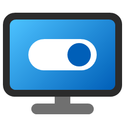
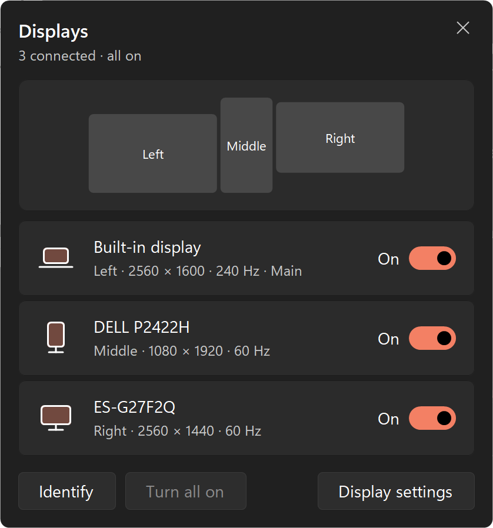
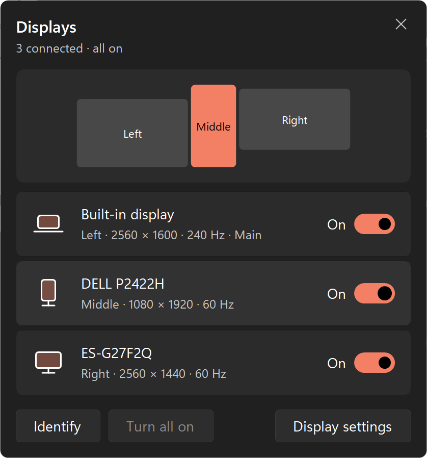
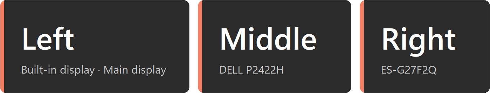
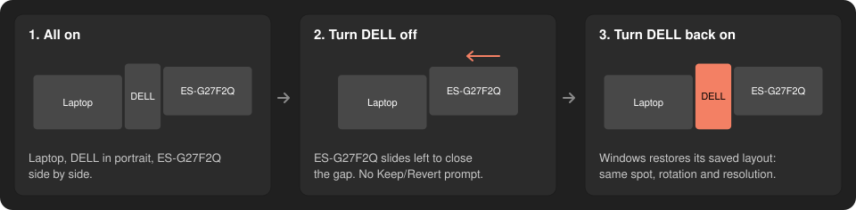
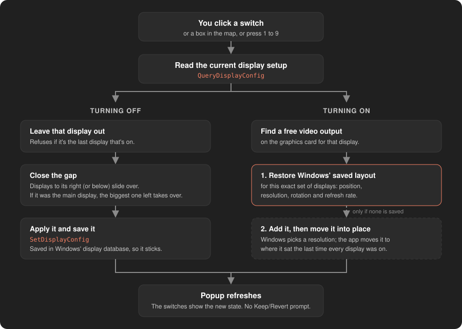

<p align="center">
  
</p>

<h1 align="center">Display Toggle</h1>

<p align="center">
  One-click on/off switches for every monitor connected to a Windows PC.<br>
  No more <em>Settings › System › Display › Disconnect this display › Keep changes</em>.
</p>

<p align="center">
  <a href="LICENSE"></a>
  
  
</p>

<p align="center"><sub>Developed by <strong>AJACE Holdings LLC</strong></sub></p>

<p align="center">
  
</p>

---

## Contents

- [Why](#why)
- [Features](#features)
- [Requirements](#requirements)
- [Install](#install)
- [Using it](#using-it)
- [How it works](#how-it-works)
- [Privacy and security](#privacy-and-security)
- [Command-line options](#command-line-options)
- [Files it creates](#files-it-creates)
- [Project layout](#project-layout)
- [Troubleshooting](#troubleshooting)
- [Limitations](#limitations)
- [Contributing](#contributing)
- [License](#license)

## Why

Turning one monitor off in Windows takes a trip through Settings: open **System › Display**, select the display,
pick **Disconnect this display** from the dropdown next to *Identify*, then confirm **Keep changes** before a
15-second countdown reverts it. Turning it back on is the same routine in reverse, one display at a time.

Display Toggle puts all of that behind one desktop icon. Double-click it, flip a switch, done.

## Features

- **Every connected display in one list.** Shows the monitor's name, where it sits (Left / Middle / Right), resolution,
  refresh rate, and which one is the main display.
- **Instant on/off.** Changes apply immediately. There's no *Keep changes / Revert* prompt.
- **Remembers your layout.** A display that comes back on returns to the same spot with the same resolution,
  rotation and refresh rate.
- **No gaps.** When a display goes off, the ones beside it slide over so your mouse doesn't hit empty space.
- **Mini map** of your real desk arrangement (portrait monitors are drawn tall). Hover a row and its box lights up.
- **Identify** labels each screen for 3 seconds so you know which is which.
- **Turn all on** in one click.
- **Looks native.** Windows 11 style, follows your light/dark setting and accent color, and stays sharp at any display scaling.
- **Light.** One small `.exe` with no installer, no background process, no admin rights, and no internet access.

## Requirements

- Windows 10 or 11 (developed on Windows 11).
- .NET Framework 4.x, which is built into Windows 10 and 11. Nothing to download.
- To build: nothing extra. The build script uses the C# compiler that ships with Windows.

## Install

### Option 1: Installer (recommended)

1. Download **[DisplayToggle-Setup.exe](../../releases/latest/download/DisplayToggle-Setup.exe)** from the
   [latest release](../../releases/latest).
2. Double-click it and choose **Yes**.

That's it. A **Display Toggle** icon appears on your desktop and in the Start menu. The installer:

- installs for your Windows account only, in `%LOCALAPPDATA%\Programs\DisplayToggle`, so **no admin rights** are needed;
- adds the desktop and Start menu icons;
- adds Display Toggle to **Settings › Apps › Installed apps**, so you can uninstall it like any other app;
- updates an older copy in place if you run a newer installer.

For IT deployment, `DisplayToggle-Setup.exe /S` installs silently.

### Option 2: Portable, no install

Download **[DisplayToggle.exe](../../releases/latest/download/DisplayToggle.exe)**, put it anywhere (a USB stick works),
and double-click it. Nothing is installed, and no icons are created.

### Option 3: Build from source

1. Click **Code › Download ZIP** at the top of this page and unzip it, or `git clone` this repository.
2. Open PowerShell in the `DisplayToggle` folder and run:

   ```powershell
   .\build.ps1 -Install
   ```

This builds `bin\DisplayToggle.exe` and `bin\DisplayToggle-Setup.exe`, then runs the installer silently.
Leave off `-Install` to only build. If PowerShell says running scripts is disabled, use
`powershell -ExecutionPolicy Bypass -File .\build.ps1 -Install`.

### "Windows protected your PC"?

The downloads aren't code-signed yet, so Microsoft SmartScreen may show this warning the first time. Choose
**More info › Run anyway**. To confirm your download wasn't tampered with, compare its SHA-256 hash with
`SHA256SUMS.txt` on the release page:

```powershell
Get-FileHash .\DisplayToggle-Setup.exe -Algorithm SHA256
```

**Tip:** right-click the desktop icon › **Properties** › **Shortcut key** to give it a hotkey such as `Ctrl + Alt + D`.

### Uninstall

Open **Settings › Apps › Installed apps**, find **Display Toggle**, and choose **Uninstall**. That removes the app,
its icons, and its saved layout and log.

Using the portable `.exe`? Delete it, and optionally delete `%LOCALAPPDATA%\DisplayToggle` (saved layout and log).

## Using it

Double-click **Display Toggle**. The popup opens in the middle of whichever screen your mouse pointer is on.

<p align="center">
  
  <br><sub>Hovering a display highlights it in the map, so you can tell which physical screen it is.</sub>
</p>

| To… | Do this |
| --- | --- |
| Turn a display off or on | Click its row, its switch, or its box in the map |
| See which screen is which | Click **Identify** |
| Turn everything back on | Click **Turn all on** (only enabled when something is off) |
| Open Windows' display settings | Click **Display settings** |
| Close the popup | Click anywhere outside it, press `Esc`, or click **×** |

**Keyboard shortcuts** (while the popup is open):

| Key | Action |
| --- | --- |
| `1` – `9` | Toggle the 1st–9th display, counting from the left |
| `↑` `↓` / `Tab` | Move between displays |
| `Space` / `Enter` | Toggle the selected display |
| `A` | Turn all on |
| `I` | Identify |
| `Esc` | Close |

### Identify

**Identify** puts a label in the bottom-left corner of every screen that's on, for 3 seconds (click one to dismiss it early):

<p align="center">
  
</p>

### What each row tells you

Take the middle row in the screenshot above: **DELL P2422H**, *Middle · 1080 × 1920 · 60 Hz*.

- **Name**: the monitor's model name from its EDID. A laptop panel shows as *Built-in display*.
- **Position**: *Left / Middle / Right* (or *Top / Bottom* for stacked screens; *2nd from left* and so on with four or more).
- **Resolution and refresh rate** while it's on, plus **Main** for the main display.
- **Connector** (*DisplayPort*, *HDMI*, …) while it's off.

### Built-in safety rules

- You can't turn off the **last** display that's on.
- The popup never quits halfway through a change. If you close it mid-change, it closes once the change finishes.
- If Windows rejects a change, nothing is changed and the reason appears in red under the list.

## How it works

### The short version

<p align="center">
  
</p>

### Under the hood

Display Toggle talks to the same Windows API that the Settings app uses:
**CCD** (*Connecting and Configuring Displays*) in `user32.dll`.

<p align="center">
  
</p>

**A few CCD terms**

- A **path** connects a *source* (a desktop surface the graphics card renders) to a *target* (a physical output with a
  monitor plugged into it). A display is **on** when its path is active.
- **Modes** describe each path's resolution, refresh rate and position on the desktop.
- Windows keeps a **display database** of the layout you last used for each combination of monitors. That's how it
  knows where everything goes when you dock or undock a laptop.

**Reading what's connected**: `QueryDisplayConfig(QDC_ALL_PATHS)` returns every possible source→target path. Any target
with a monitor plugged in (`targetAvailable`) is listed. If one of its paths is active, it's on.
`DisplayConfigGetDeviceInfo` provides the monitor's name, connector type and a stable device path used as its ID.
A rotated (portrait) display reports its size *before* rotation, so width and height are swapped for 90°/270°.

**Turning a display off**

1. Take the currently active paths and leave out the one for that display.
2. **Close the gap**: any display that sat to its right (sharing a row) moves left by its width. Any display below it
   (sharing a column) moves up by its height.
3. Windows requires the main display to sit at position (0, 0). If the display going off *was* the main display, the
   largest remaining one becomes the main display and everything shifts to match.
4. Apply with `SetDisplayConfig(SDC_USE_SUPPLIED_DISPLAY_CONFIG | SDC_ALLOW_CHANGES | SDC_APPLY | SDC_SAVE_TO_DATABASE)`.
   Saving to the database is what makes the change stick after a restart.

**Turning a display on**

1. Find a free *source* on the graphics card for that display's output (each card can drive a limited number at once).
2. **Preferred:** ask Windows to restore the saved layout for this exact set of displays with
   `SetDisplayConfig(SDC_TOPOLOGY_SUPPLIED | SDC_APPLY)`. This brings back position, resolution, rotation and refresh
   rate exactly as they were.
3. **Fallback** if Windows has no saved layout for that combination: keep the current displays as they are, add the new
   one with no mode so Windows picks one (`SDC_ALLOW_CHANGES`), then move everything to the layout the app remembered
   from the last time every display was on.

**Turn all on** does the same for every display that's off in one step. If that fails, it falls back to
`SDC_TOPOLOGY_EXTEND`, which is exactly what **Win + P › Extend** does.

**Remembered layout**: whenever *all* connected displays are on, the app saves where each one sits to `layout.txt`.
That arrangement is used to draw the mini map while some displays are off, so screens don't jump around, and to put
displays back in place in the fallback case above.

**The popup** is a single custom-drawn WinForms window. It's per-monitor DPI aware, reads your light/dark theme and
accent color from the registry, and runs each display change on a background thread so it stays responsive while the
screens re-sync. It refreshes automatically if displays change behind its back (a cable is plugged in, Win + P, Settings).

## Privacy and security

- **No admin rights.** The app runs as your normal user (`asInvoker`) and can only change what you could change in
  Settings yourself: which displays are on and where they sit.
- **No network access.** It never connects to the internet: no telemetry, no analytics, no update checks.
- **Your data stays on your PC.** The only files it writes are the layout and log in `%LOCALAPPDATA%\DisplayToggle`
  (see [Files it creates](#files-it-creates)).
- **Hardened DLL loading.** Windows libraries are loaded only from `System32`, never from the folder the `.exe` sits
  in, so a malicious DLL dropped next to a downloaded copy can't be picked up.
- **Small and readable.** About 1,700 lines of C# with no third-party dependencies, so the whole thing can be reviewed
  in one sitting.

Found a security problem? Please don't open a public issue. Report it privately from this repository's **Security**
tab › **Report a vulnerability**.

## Command-line options

| Option | What it does |
| --- | --- |
| *(none)* | Opens the popup. If it's already open, brings it to the front. |
| `--all-on` | Turns every connected display on without opening the popup. Handy as a second shortcut or hotkey. |
| `--diagnose` | Writes a report of every display to `%LOCALAPPDATA%\DisplayToggle\diagnose.txt`, then asks Windows to **check** (not apply) turning each one off/on. Safe to run any time. |

## Files it creates

Everything lives in `%LOCALAPPDATA%\DisplayToggle`. Nothing is sent anywhere.

| File | Contents |
| --- | --- |
| `layout.txt` | Where each display sat the last time they were all on (device ID, position, size, main display, rotation) |
| `log.txt` | One line per change and its result. Cleared automatically once it passes 256 KB. |
| `diagnose.txt` | Only created by `--diagnose` |

## Project layout

| Path | Purpose |
| --- | --- |
| `src/NativeMethods.cs` | P/Invoke declarations for the CCD API and a few window helpers |
| `src/DisplayManager.cs` | Lists displays, turns them off/on, closes gaps, remembers the layout, logging |
| `src/ToggleForm.cs` | The popup: layout, painting, mouse/keyboard input, flyout behavior |
| `src/IdentifyOverlay.cs` | The corner label shown by **Identify** |
| `src/Ui.cs` | Theme (light/dark, accent color), fonts, drawing helpers, per-monitor DPI |
| `src/Program.cs` | Entry point, command-line options, single-instance handling |
| `src/AssemblyInfo.cs` | Version, company and copyright shown in the `.exe`'s Properties; DLL-loading hardening |
| `src/app.manifest` | Per-monitor DPI awareness, runs without admin rights |
| `tools/New-AppIcon.ps1` | Draws the app icon and writes a multi-size `.ico` |
| `installer/Setup.cs` | The installer/uninstaller (per-user, no admin). The app is embedded inside it. |
| `installer/setup.manifest` | Keeps the installer from asking for admin rights |
| `build.ps1` | Builds the app and installer; `-Install` installs on this PC, `-Package` prepares release files in `dist\` |
| `LICENSE` | MIT License |

## Troubleshooting

**A display stayed off and I can't see the popup.** Press **Win + P** and choose **Extend**. Windows will turn every
display back on. Running `DisplayToggle.exe --all-on` does the same.

**"Windows rejected the change: …"** Windows refused that configuration, so nothing changed. Run
`DisplayToggle.exe --diagnose` and check `%LOCALAPPDATA%\DisplayToggle\log.txt` to see which step failed.

**"Windows has no free video output for …"** Your graphics card is already driving as many displays as it can.
Turn another one off first.

**A display came back in the wrong place.** Arrange it once in Windows Settings with every display on. The app picks
up that arrangement the next time it opens with all displays on.

## Limitations

- Developed and checked on one setup: a Windows 11 laptop's built-in screen plus two DisplayPort monitors (one in
  portrait). It hasn't been tried with USB docks/DisplayLink, NVIDIA Surround / AMD Eyefinity, or duplicated
  (mirrored) displays.
- Skipping the *Keep changes / Revert* prompt also skips its safety net. If the only display left on is one you can't
  see (a TV on another input, say), use **Win + P › Extend** to recover.
- The `.exe` isn't code-signed, so SmartScreen and some antivirus tools may warn about it.

## Contributing

Bug reports, ideas and pull requests are welcome through GitHub Issues and Pull Requests.

When reporting a display problem, please include:

- your Windows version and how the displays are connected (laptop screen, HDMI, DisplayPort, USB-C dock, …);
- the contents of `%LOCALAPPDATA%\DisplayToggle\diagnose.txt` after running `DisplayToggle.exe --diagnose`.
  It lists your monitors' model names and Windows device IDs, so look it over before posting.

To work on the code, edit the files in `src/` and run `.\build.ps1`. There's no project file or SDK to set up.

## License

Display Toggle is released under the [MIT License](LICENSE).
Copyright © 2026 AJACE Holdings LLC.

You're free to use, copy, modify and share it, including commercially, as long as the copyright notice and license
text come along with it. It's provided as-is, without warranty.

---

<p align="center"><sub>Display Toggle is developed and maintained by <strong>AJACE Holdings LLC</strong>.</sub></p>
